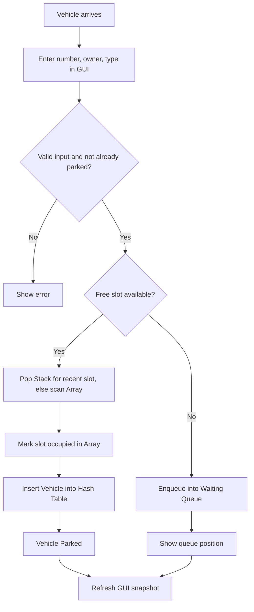
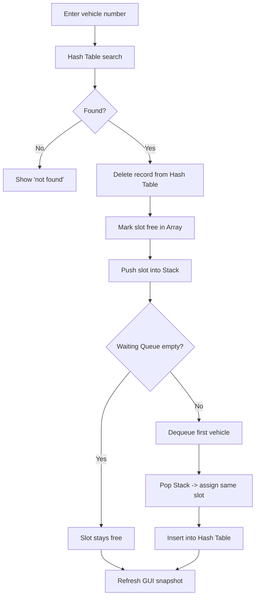

# Smart Parking Space Management System
### A Data Structures Course Project — C++ Engine + Python Tkinter GUI

> **Subject:** Data Structures  
> **Languages:** C++ (core logic) · Python/Tkinter (visual interface)  
> **Core idea:** Every parking operation is powered by a hand-written data structure, and the GUI **shows the data structures working live** so the implementation is visible during demo and viva.

---

## 1. Project Overview

Parking areas in colleges, offices, hospitals and malls have limited slots. Managing them manually makes it hard to find free slots, locate a vehicle, handle a waiting list, and track occupancy.

This project solves it with four fundamental data structures:

| Data Structure | Role in the project | Operations | Complexity |
|---|---|---|---|
| **Array** | Stores status of every parking slot (P01…P20) | access, update | O(1) |
| **Queue (FIFO)** | Waiting list when the parking is full | enqueue, dequeue | O(1) |
| **Stack (LIFO)** | Recently vacated slots (reused first) | push, pop | O(1) |
| **Hash Table** | Vehicle records, searched by vehicle number | insert, search, delete | O(1) average |
| **Class / Struct** | `Vehicle` (number, owner, type, slot, entry time) | create, read, update | O(1) |

> The data structures are **implemented from scratch** in C++ (not just STL wrappers), so the course concepts are demonstrated clearly. STL is only used for `std::string`, `std::vector` as raw storage, and I/O.

---

## 2. Architecture

The project is split into two layers that talk through a simple text protocol.

```
┌────────────────────────────────────────────┐
│            Tkinter GUI  (Python)           │
│  Forms · Slot grid · Queue view ·          │
│  Stack view · Hash-table bucket view · Log │
└───────────────┬────────────────────────────┘
                │  JSON commands / JSON responses
                │  (stdin / stdout of a subprocess)
┌───────────────▼────────────────────────────┐
│          C++ Parking Engine (parking.exe)  │
│  ┌───────┐ ┌───────┐ ┌───────┐ ┌─────────┐ │
│  │ Array │ │ Queue │ │ Stack │ │HashTable│ │
│  └───────┘ └───────┘ └───────┘ └─────────┘ │
│            ParkingManager (logic)          │
└────────────────────────────────────────────┘
```

**Why this design?**
- All data-structure logic stays in **C++**, as required by the synopsis.
- The GUI never touches the data directly — it only sends commands and **draws the state** the engine returns.
- After every command the engine returns a full **snapshot** of all four data structures, so the GUI can display exactly what is inside each one.

---

## 3. Folder Structure

```
SmartParking/
├── README.md
├── Makefile                  # build the C++ engine
├── cpp/
│   ├── main.cpp              # command loop (reads JSON, calls manager, prints JSON)
│   ├── Vehicle.h             # Vehicle class
│   ├── SlotArray.h           # Array of parking slots
│   ├── WaitingQueue.h        # Queue (linked list or circular array)
│   ├── VacatedStack.h        # Stack of recently freed slots
│   ├── VehicleHashTable.h    # Hash table (separate chaining)
│   ├── ParkingManager.h/.cpp # ties everything together
│   └── json_out.h            # small helper to print state as JSON
├── gui/
│   ├── app.py                # Tkinter main window
│   ├── engine.py             # starts parking.exe, send()/receive() helpers
│   ├── panels.py             # slot grid, queue, stack, hash-table widgets
│   └── theme.py              # colours and fonts
└── docs/
    └── DS_Synopsis.pdf
```

---

## 4. How Each Data Structure Is Implemented

### 4.1 Array — parking slots
```cpp
struct Slot {
    string id;            // "P01", "P02", ...
    bool   occupied;
    string vehicleNo;     // empty if free
};
Slot slots[MAX_SLOTS];    // MAX_SLOTS = 20 (configurable)
```
- Slot `P05` is simply `slots[4]` → **O(1) access and update**.
- Finding the first free slot is a linear scan, O(n), used only when the stack has no usable slot.

### 4.2 Queue — waiting vehicles (FIFO)
- Implemented as a **linked list with `front` and `rear` pointers** (or a circular array).
- `enqueue(vehicle)` adds at the rear, `dequeue()` removes from the front — both **O(1)**.
- The first vehicle that arrived when the parking was full is the first to get a slot.

### 4.3 Stack — recently vacated slots (LIFO)
- Implemented with an **array + `top` index**.
- When a vehicle exits, its slot number is `push`ed. 
- When allocating, the engine first `pop`s the stack → **the most recently vacated slot is reused first**.
- *Stale-entry safety:* a popped slot is checked; if it was already taken through a scan, it is skipped and the next one is popped.

### 4.4 Hash Table — vehicle records
- **Key:** vehicle number (e.g. `MH12AB1234`). **Value:** `Vehicle` record (owner, type, slot, entry time).
- **Hash function:** polynomial rolling hash  
  `h = (h * 31 + ch) % TABLE_SIZE` over every character.
- **Collision handling:** **separate chaining** — each bucket is a linked list.
- `insert`, `search`, `remove` are **O(1) on average** (O(n) worst case if every key collides).
- The GUI shows every bucket and its chain, so collisions are visible.

### 4.5 Vehicle class
```cpp
class Vehicle {
public:
    string number, owner, type;   // Car / Bike / ...
    string slotId;                // "" while waiting
    time_t entryTime;
};
```

---

## 5. Command Protocol (GUI ⇄ C++)

The GUI sends one JSON line per command; the engine replies with one JSON line.

| Command | Request example | What the engine does |
|---|---|---|
| `add_vehicle` | `{"cmd":"add","no":"MH12AB1234","owner":"Rahul Patil","type":"Car"}` | Validate → allocate slot **or** enqueue |
| `exit_vehicle` | `{"cmd":"exit","no":"MH12AB1234"}` | Hash search → free slot → push to stack → promote from queue |
| `search` | `{"cmd":"search","no":"MH12AB1234"}` | Hash search, returns record + bucket index |
| `status` | `{"cmd":"status"}` | Counts + full snapshot |
| `reset` | `{"cmd":"reset"}` | Clears everything |

**Response (simplified):**
```json
{
  "ok": true,
  "message": "MH12AB1234 parked at P05",
  "trace": ["hash('MH12AB1234') = bucket 7", "Stack empty -> scanned array", "slots[4] = occupied"],
  "slots":  [{"id":"P01","occ":true,"veh":"MH12AA1111"}, ...],
  "queue":  ["MH12FF6666", "MH12GG7777"],
  "stack":  ["P02", "P09"],
  "hash":   {"0":[], "7":[{"no":"MH12AB1234","slot":"P05"}], ...},
  "stats":  {"total":20,"occupied":5,"free":15,"waiting":0}
}
```
The **`trace`** array is what makes the implementation *visible*: it lists, step by step, which data structure was touched and how.

---

## 6. System Workflow

### 6.1 Vehicle Entry


### 6.2 Vehicle Exit


### 6.3 Worked Example (from the synopsis)
1. Add 5 vehicles → they take `P01`–`P05`; Array shows 5 occupied, Hash Table shows 5 records.
2. Add `MH12FF6666` → all full → goes into the **Queue**.
3. `MH12BB2222` exits → record deleted from Hash Table, `P02` freed, **`P02` pushed on Stack**.
4. Engine dequeues `MH12FF6666`, pops `P02`, assigns it → Queue empty, Stack empty again.

---

## 7. GUI Design (Tkinter)

The window is a dashboard whose panels map **one-to-one** to the data structures:

```
┌───────────────────────────────────────────────────────────────┐
│ SMART PARKING MANAGEMENT SYSTEM            Total 20 | Free 15 │
├───────────────┬───────────────────────────────────────────────┤
│  CONTROLS     │  ARRAY VIEW – Parking Slots                   │
│  Vehicle No   │  [P01][P02][P03][P04][P05] ... green = free,  │
│  Owner        │  red = occupied (hover shows vehicle)         │
│  Type  [v]    ├───────────────────────┬───────────────────────┤
│  [Add Vehicle]│  QUEUE VIEW (FIFO)    │  STACK VIEW (LIFO)    │
│  [Exit]       │  front → [A][B][C]    │  top → P09            │
│  [Search]     │        ← rear         │         P02           │
│  [Reset]      ├───────────────────────┴───────────────────────┤
│               │  HASH TABLE VIEW – buckets 0…N and chains     │
│               │  [7] → MH12AB1234 → MH12CD5678 (collision)    │
├───────────────┴───────────────────────────────────────────────┤
│  OPERATION LOG: step-by-step trace from the C++ engine        │
└───────────────────────────────────────────────────────────────┘
```

**Visibility features (for the course evaluation):**
- **Colour-coded array grid** — instantly shows slot status.
- **Queue and Stack drawn as boxes** with front/rear and top markers; items animate in and out (enqueue/dequeue, push/pop).
- **Hash-table panel** lists every bucket and chain; the searched/inserted bucket is **highlighted**.
- **Operation log** prints the engine `trace`, e.g.  
  `hash("MH12BB2222") → bucket 3` · `Delete from bucket 3` · `slots[1] = FREE` · `push P02` · `dequeue MH12FF6666` · `pop P02`.
- **Complexity tag** shown beside each operation (e.g. `Hash search: O(1) avg`).

---

## 8. Menu ↔ GUI Mapping

| Synopsis menu option | GUI element |
|---|---|
| 1. Add Vehicle | Form + **Add Vehicle** button |
| 2. Allocate Parking | Automatic on add; also triggered when a slot frees up |
| 3. Vehicle Exit | **Exit** button |
| 4. Search Vehicle | **Search** button (highlights bucket) |
| 5. Display Parking Status | Slot grid + counters |
| 6. Display Waiting Queue | Queue panel |
| 7. Display Recently Vacated Slots | Stack panel |
| 8. Display All Vehicles | Vehicle table / Hash-table panel |
| 9. Exit | Window close (engine shut down cleanly) |

---

## 9. Build and Run

**Requirements:** g++ (C++17), Python 3.8+ (Tkinter is bundled with the standard Python installer; on Ubuntu: `sudo apt install python3-tk`).

```bash
# 1. Build the C++ engine
cd SmartParking
g++ -std=c++17 -O2 cpp/*.cpp -o parking        # Windows: -o parking.exe

# 2. Run the GUI
python gui/app.py
```
Optional `Makefile`:
```make
all:
	g++ -std=c++17 -O2 cpp/*.cpp -o parking
```

**Test the engine without the GUI:**
```bash
echo '{"cmd":"status"}' | ./parking
```

---

## 10. Suggested Development Plan

| Step | Task |
|---|---|
| 1 | Write `Vehicle`, `SlotArray`, `WaitingQueue`, `VacatedStack`, `VehicleHashTable` with a small `main()` test each |
| 2 | Write `ParkingManager` (add, exit, search, status) and verify with the 5-slot example |
| 3 | Add JSON output + `trace` generation |
| 4 | Build `engine.py` (subprocess wrapper) and test from Python |
| 5 | Build the Tkinter panels one by one: Array → Queue → Stack → Hash Table → Log |
| 6 | Add highlights/animations, input validation, error messages |
| 7 | Test edge cases (below), write report, prepare demo |

---

## 11. Test Cases

| # | Scenario | Expected result |
|---|---|---|
| 1 | Add vehicle with free slots | Gets a slot; Hash Table has the record |
| 2 | Add duplicate vehicle number | Rejected with message |
| 3 | Add vehicle when full | Enqueued; queue position shown |
| 4 | Exit a parked vehicle | Slot freed, pushed on Stack, queue head promoted |
| 5 | Exit unknown vehicle | "Not found" |
| 6 | Search existing / missing vehicle | Record shown / "Not found" |
| 7 | Two keys in the same bucket | Chain displayed correctly; delete works on either |
| 8 | Several exits, then several entries | Slots reused in LIFO order |
| 9 | Several vehicles waiting | Served in FIFO order |
| 10 | Empty input / invalid plate | Validation error, nothing changes |

---

## 12. Advantages
- Fast vehicle lookup, O(1) average, through the hash table.
- Fair FIFO waiting list; automatic allocation.
- Clear visual proof of how each data structure works.
- Modular code — each structure is in its own file and can be tested alone.

## 13. Limitations
- Data is in memory only (lost on close) — no database/file storage yet.
- Designed for small and medium parking areas.
- No sensors, payments or reservations in this version.

## 14. Future Scope
Save/load records (file or SQLite) · parking-fee calculation · digital tickets · admin login · multiple parking areas · QR-code entry/exit · number-plate recognition · reports and history · mobile app.

---

## 15. References
- Data Structures and Algorithms using C++ — standard academic reference material.
- C++ Standard Library and compiler documentation.
- Python `tkinter` documentation.
- Course notes and Data Structures laboratory material.

---

## 16. Team / Submission Details
| Field | Details |
|---|---|
| Student name(s) | _fill in_ |
| Roll number(s) | _fill in_ |
| Class / Division | _fill in_ |
| Guide / Faculty | _fill in_ |
| Academic year | _fill in_ |
